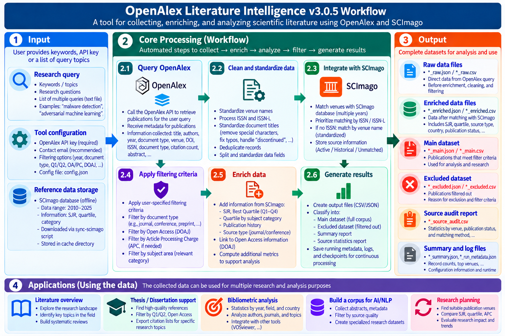

# OpenAlex Literature Intelligence

[](https://doi.org/10.5281/zenodo.23680134)    

A command-line tool that turns a literature search into an auditable corpus. It finds works in
[OpenAlex](https://openalex.org/), attaches SCImago venue data (SJR, quartiles, categories, estimated
APC) both for the year each paper was published and for the latest snapshot, screens a main corpus with
a policy you declare, records why every paper was kept or excluded, and downloads the open-access full
texts, with a list of the rest to fetch by hand.

```text
query -> OpenAlex discovery -> deduplication -> SCImago 2010-2025 enrichment
      -> policy screening -> raw / enriched / main / excluded / audit outputs
      -> fetch-oa: open-access PDFs + manual-download list
```



Workflow overview. The exact output file names are listed under [Outputs](#outputs).

## What it does

- **Discovery.** One or many OpenAlex queries, cursor paging, resume after interruption, and
  deduplication by DOI, then OpenAlex ID, then normalized title and year. Queries match the full text
  where OpenAlex has it, or only titles and abstracts with `--search-field title_and_abstract` (v3.2.0,
  see [Search field](#search-field)).
- **Venue enrichment.** Each source is matched to the SCImago snapshots of 2010-2025 by ISSN, then
  ISSN-L, then title. A title match is never accepted when the ISSNs contradict each other.
- **Publication-year ranking.** SJR, Best Quartile and category quartiles come from the snapshot of the
  publication year. Nothing is interpolated: a 2026 paper gets latest metadata
  (`ranking_basis = LATEST_AVAILABLE`), not an invented 2026 quartile.
- **Source status.** `ACTIVE_LATEST`, `HISTORICAL_ONLY`, `UNMATCHED` or `AMBIGUOUS`, relative to the
  latest snapshot.
- **Screening.** The default main corpus is journals with status `ACTIVE_LATEST`. Optional filters:
  quartile (publication-year or latest, Best Quartile or a chosen category), estimated APC ceiling,
  DOAJ, CWTS Core, source type, retracted works.
- **Quality signals and venue tiers (v3.1.0).** Each record keeps the retraction flag and the
  field-normalized citation measures of OpenAlex, and can be labelled with the tier of its venue from a
  list you maintain. From v4.1.0, `--admit-tier` admits the listed venues of chosen tiers to the main
  corpus, including conferences absent from SCImago, and preprints are listed in a separate file for
  manual screening.
- **Audit trail.** The raw corpus is never overwritten; every excluded paper carries its exclusion
  reasons; a per-source audit, a summary and run metadata (tool version, policy, manifest, environment)
  are written with each run; every SCImago file is verified by SHA-256.
- **Open-access full text (v3.1.0).** `fetch-oa` downloads the PDFs that OpenAlex lists as open access,
  politely and sequentially. A host that answers with a bot check is never requested again, and every
  paper it could not fetch goes to a manual-download list (CSV, HTML, RIS for Zotero).

## What it does not do

- It does not search Scopus or Web of Science; discovery uses the OpenAlex Works API.
- It does not download subscription full text and never tries to get past a bot check or CAPTCHA.
- Presence in SCImago is not proof of current Scopus indexing, and absence is not evidence that a
  venue is predatory. The tool never makes either claim.
- APC values are estimates from a 2025 snapshot, not official publisher prices.
- It supports, but does not replace, a systematic-review protocol and title, abstract and full-text
  screening.

## Quick start

Requirements: Python 3.11 or newer, Internet access, and an OpenAlex API key (see
https://help.openalex.org/api/authentication/). Only `run` needs the key.

Windows PowerShell:

```powershell
git clone https://github.com/tvquynh/openalex-literature-intelligence.git
cd openalex-literature-intelligence
python -m venv .venv
.\.venv\Scripts\Activate.ps1
python -m pip install -r requirements.txt
Copy-Item config.example.json config.json   # then put your key in openalex.api_key
```

Linux or macOS:

```bash
git clone https://github.com/tvquynh/openalex-literature-intelligence.git
cd openalex-literature-intelligence
python3 -m venv .venv
source .venv/bin/activate
python -m pip install -r requirements.txt
cp config.example.json config.json          # then put your key in openalex.api_key
```

Download and verify the SCImago data (about 185 MB, once), then run a 100-paper pilot:

```bash
python literature_pipeline.py sync-scimago
python literature_pipeline.py validate-repo
python literature_pipeline.py run --query "malware detection machine learning" --from-year 2020 --to-year 2026 --require-abstract --max-per-query 100 --output pilot
```

`config.json` is private and listed in `.gitignore`. Settings are resolved in the order: command-line
argument, then `config.json`, then the built-in default. The `OPENALEX_API_KEY` environment variable is
still read after `config.json` for backward compatibility, but it is deprecated.

## Commands

| Command | Purpose | Needs API key |
|---|---|---|
| `sync-scimago` | Download the SCImago mirror into the local cache and verify every file by SHA-256 | no |
| `validate-repo` | Check the cache against `SHA256SUMS.txt` (`--offline` uses the cache only) | no |
| `run` | OpenAlex discovery, SCImago enrichment, screening and audit outputs | yes |
| `enrich` | Re-enrich and re-screen an existing OpenAlex CSV/JSONL without querying OpenAlex | no |
| `inspect-source` | Show one venue's SCImago history by `--title` or `--issn` | no |
| `fetch-oa` | Download the open-access PDFs of a corpus file and list the rest for manual download | no |

Common screening options (for `run` and `enrich`):

| Option | Effect on the main corpus |
|---|---|
| `--quartile Q1 --quartile Q2` | keep the selected quartiles |
| `--quartile-basis latest` or `publication` | quartile of the latest snapshot (default), or of the publication year; see [Quartile basis and papers newer than the SCImago data](#quartile-basis-and-papers-newer-than-the-scimago-data) |
| `--quartile-mode relevant-category --relevant-category "Software"` | use the quartile of the named categories instead of Best Quartile |
| `--max-apc 1000` | keep venues with an estimated APC of at most 1000 USD |
| `--require-doaj`, `--require-cwts-core` | keep sources that OpenAlex lists in DOAJ or in the CWTS Core list |
| `--source-type journal --source-type "conference and proceedings"` | allowed SCImago source types (default: journal) |
| `--all-source-types` | drop the journal-only default |
| `--include-historical-only`, `--any-source-status` | also admit `HISTORICAL_ONLY` sources, or disable status filtering |
| `--exclude-retracted` | drop works that OpenAlex marks as retracted (reason `RETRACTED`) |
| `--venue-tiers my_venues.tsv` | no effect on the main corpus by itself: adds the tier columns described under [Quality signals and venue tiers](#quality-signals-and-venue-tiers) |
| `--admit-tier A --admit-tier B` | admit papers of venues listed with these tiers even when the SCImago status, source-type or quartile filters would exclude them; see [Admitting listed venues](#admitting-listed-venues) |
| `--no-admit-tiers` | admit no tier, overriding `screening.admit_tiers` in `config.json` |

Filters combine with AND. Records that fail a filter go to `_excluded.csv` with the reason, so a
stricter or looser policy can be applied later with `enrich` without querying OpenAlex again.

### Quartile basis and papers newer than the SCImago data

By default (`--quartile-basis latest`), `--quartile` screens every paper by its venue's quartile in the
latest SCImago snapshot, so the newest papers are not lost. A 2026 paper is kept when its venue is in
the selected quartiles of the 2025 snapshot; that is the venue's 2025 quartile, not a 2026 quartile. An
older paper is also judged by its venue's 2025 quartile, not by the quartile in its year of
publication. Sources found only in earlier snapshots (`HISTORICAL_ONLY`, admitted with
`--include-historical-only`) have no latest quartile and fail a quartile filter on this basis. Up to
v3.3.0 the default was `publication`; pass `--quartile-basis publication` to keep that behavior.

`--quartile-basis publication` screens each paper by the quartile of the year it was published, which
suits historical analyses. The SCImago data end at 2025, so a 2026 paper has no publication-year quartile
and fails the filter; the tool never copies the 2025 quartile into the publication-year columns. When the
source is in the latest snapshot (`ranking_basis = LATEST_AVAILABLE`), the paper's exclusion reasons are
`QUARTILE_UNAVAILABLE; QUARTILE_PUBLICATION_YEAR_NOT_AVAILABLE`, and `run` and `enrich` print a warning
with the number of such papers:

```text
WARNING: SCImago data ends at 2025. 12 papers published after 2025 have no publication-year quartile and failed the current quartile filter (QUARTILE_PUBLICATION_YEAR_NOT_AVAILABLE). Use --quartile-basis latest (the default) to screen them using the latest available SCImago snapshot (not a quartile of their publication year).
```

`_summary.json` always contains this count, which is 0 without `--quartile` or with the latest basis:

```json
"quartile_filter_diagnostics": {
  "quartile_filter": ["Q1", "Q2"],
  "basis": "publication",
  "mode": "best",
  "scimago_latest_year": 2025,
  "future_year_papers_without_publication_quartile": 12
}
```

The example above comes from `enrich` on 100 papers of a 2010-2026 query with `--all-source-types
--quartile Q1 --quartile Q2 --quartile-basis publication`: 36 were published in 2026, 12 of them in venues
present in the 2025 snapshot, and the main corpus had 13 papers. With the default latest basis, the main
corpus of the same papers has 22.

## Outputs

For `--output pilot`:

| File | Content |
|---|---|
| `pilot_raw.csv`, `pilot_raw.jsonl` | unique OpenAlex records before enrichment |
| `pilot_enriched.csv`, `pilot_enriched.jsonl` | raw records plus SCImago fields, status, match method and diagnostics |
| `pilot_main.csv` | records that pass the active policy |
| `pilot_excluded.csv` | the other records, with `main_exclusion_reasons` |
| `pilot_source_audit.csv` | one row per OpenAlex source: status, match method, candidates, paper count |
| `pilot_summary.json` | counts by status, source class, match method, quartile and ranking basis; `quartile_filter_diagnostics` |
| `pilot_run_metadata.json` | tool version, queries, search field, policy, manifest and environment; records whether a key was configured, never the key |
| `pilot_checkpoint.json` | cursor and progress per query, used to resume |
| `pilot_preprints.csv` | preprints and repository records (arXiv, Zenodo, university archives), most cited first, for manual screening; same columns as the enriched file |

## Search field

By default `run` sends each query to the OpenAlex `search` parameter, which matches the title, the
abstract and, where OpenAlex has indexed it, the full text. From v3.2.0, `--search-field
title_and_abstract` (or `run.search_field` in `config.json`) sends the query to the
`title_and_abstract.search` filter instead, so only titles and abstracts are matched.

```bash
python literature_pipeline.py run --query 'malware AND ("concept drift" OR "temporal drift" OR "dataset shift")' --search-field title_and_abstract --require-abstract --from-year 2010 --to-year 2026 --output drift
```

On 27 October 2026 this query (2010-2026, abstract required) matched 3,124 works with `search` and 228
with `title_and_abstract`. All 228 contain the terms in their title or abstract, while 15 of the first 100
works returned by `search` do not mention malware there. The narrower field also misses relevant papers
whose titles and abstracts use other words, so compare both fields on a set of papers you already know
before a large collection.

A `title_and_abstract` query cannot contain `,` or `|`, which separate and combine OpenAlex filter values;
such a query is refused before any request (join the terms with `OR`). The search field is recorded in
the run metadata, the summary and the checkpoint. Resuming with a different field stops with an error;
use `--no-resume` or a new `--output` prefix.

## Quality signals and venue tiers

From v3.1.0, every record that `run` retrieves keeps these OpenAlex fields:

| Column | Meaning |
|---|---|
| `is_retracted` | OpenAlex marks the work as retracted |
| `fwci` | field-weighted citation impact: citations received relative to those expected for works of the same publication year and field |
| `citation_normalized_percentile` | citation percentile among comparable works (0 to 1) |
| `citation_top_1_percent`, `citation_top_10_percent` | whether that percentile is in the top 1% or 10% |

OpenAlex computes the citation measures when the query runs (see its documentation for the exact
definitions), so they change as citations accrue, carry little information for papers from the last year
or two, and are empty when OpenAlex has not computed them. Records retrieved with an older version lack
these columns; `enrich` cannot add them, so run `run` again. `--exclude-retracted` moves retracted works to
`_excluded.csv`; the citation measures are never used as filters.

`--venue-tiers my_venues.tsv` labels each paper with the tier of its venue from a list you write and
approve. It removes nothing from the main corpus. The list is a tab-separated file (comma-separated if
its name ends in `.csv`) with one row per venue:

```text
tier	venue	openalex_source_id	issn	title_exact	title_contains
A	IEEE Transactions on Information Forensics and Security		1556-6013; 1556-6021
A	USENIX Security Symposium				usenix security symposium
```

A venue is recognised by its OpenAlex source ID, then an ISSN, then its whole OpenAlex source name
(`title_exact`), then a phrase in that name (`title_contains`: whole words, the longest listed phrase
wins). Names ignore case, punctuation and accents, and `&` counts as `and`. Each ID, ISSN or phrase may
belong to one venue only, and a malformed list stops the command before any download. Three columns are
added to the enriched, main, excluded and source-audit files:

- `venue_tier`: your tier, `UNLISTED` when the venue is not in the list, or `AMBIGUOUS` when it matches two
  listed venues at the same step (fix the list rather than choosing by hand);
- `venue_tier_venue`: the listed venue, or both venues when ambiguous;
- `venue_tier_match`: the step that decided (`openalex_source_id`, `issn`, `title_exact`, `title_contains`).

The summary counts papers and sources per tier, and the run metadata records the list's SHA-256. A
starting point is [examples/venue_tiers_example.tsv](examples/venue_tiers_example.tsv); its tiers are
examples, not a recommendation. Two facts are worth knowing when you write a list: SCImago assigns no quartile to
conference proceedings, so a quartile filter cannot rank conferences; and conference papers printed in a
book series such as Lecture Notes in Computer Science carry the series as their OpenAlex source, so such a
conference cannot be recognised by name.

### Admitting listed venues

The default main corpus keeps journals of the latest SCImago snapshot, which leaves out strong
conferences: many are absent from SCImago, and those present have no quartile. From v4.1.0,
`--admit-tier A --admit-tier B` admits every paper whose venue has tier A or B in your `--venue-tiers` list,
even when the SCImago status, source-type or quartile filters would exclude it. The APC, DOAJ, CWTS Core
and retraction filters still apply. Two columns record the decision: `main_admission_tier` (the admitted
tier) and `main_waived_reasons` (the venue filters that were set aside), and the summary counts the papers
admitted this way under `admission_by_venue_tier`. A tier that is not in the list, a reserved name, or
`--admit-tier` without a list stops the command before any download.

Both settings can be made defaults in `config.json`; `--no-admit-tiers` turns admission off for a
journal-only view:

```json
"screening": {
  "venue_tiers": "my_venues.tsv",
  "admit_tiers": ["A", "B"]
}
```

On 100 papers of a live 2010-2026 query, a list with the major security and machine-learning conferences
in tiers A and B raised the main corpus from 25 to 38 papers, all 13 from conferences such as NDSS, ACM
CCS, ACSAC and the ACM AISec workshop.

### Preprints

Preprints are not admitted wholesale: most are not peer reviewed, and the same work often appears later
in a journal or conference. Every `run` and `enrich` instead writes `<output>_preprints.csv`, with the works
that OpenAlex types as preprints or whose source is a repository (arXiv, Zenodo, a university archive),
most cited first (the top-10% citation flag, then the citation percentile, then the citation count).
The file has the same columns as the enriched file, so `fetch-oa` can read it, and the summary reports
the counts under `preprints`. Important preprints, such as datasets released only on arXiv, are best
reached through the papers that cite them.

OpenAlex sometimes gives a repository copy as the primary location of a paper that appeared at a
conference or in a journal, for example a university archive for a USENIX Security paper. The tool reads
the source of the primary location only, so such a paper is listed in `_preprints.csv` and is not
admitted by `--admit-tier`, even when its venue is in your list. When screening the preprint list, look
for the published version of each work.

## Open-access full text

```bash
python literature_pipeline.py fetch-oa --input pilot_main.csv --limit 20   # pilot: try 20 papers
python literature_pipeline.py fetch-oa --input pilot_main.csv              # whole file; rerun at any time
```

`fetch-oa` reads any `run` or `enrich` output and needs no API key: it uses the `best_oa_pdf_url` and
`oa_url` columns already in the file, and sends no request to OpenAlex.

- Requests are sequential, at least `--delay` seconds apart per host (default 2, minimum 1, or a longer
  robots.txt Crawl-delay), with the tool's User-Agent. robots.txt is respected (RFC 9309 matching, redirects
  followed); a host whose robots.txt cannot be read is skipped for that run.
- A host that answers with a bot check (a challenge or CAPTCHA page, HTTP 403, or a `tdm-reservation: 1`
  header) is written at once to `blocked_hosts.json` and receives no further request, in this run or later
  runs. Redirects are followed one hop at a time, so a link never reaches a blocked host, and hosts that
  redirect to a bot check are blocked too. The tool never tries to get past a bot check; to try a host
  again, delete its entry.
- HTTP 429, a 5xx answer with Retry-After, and repeated network failures only pause a host for the current
  run. DOI and handle resolvers (doi.org and similar) are never blocked. A resolver that only redirected
  to a bot check is not paused either, because its next DOI may lead to another publisher; one that
  answers with a bot check itself is paused for the run.
- Only complete PDFs (starting with `%PDF-`, ending with `%%EOF`, up to `--max-mb`, default 100 MB) are kept.
  Progress is saved after every paper, so Ctrl+C or a crash loses nothing.

The output folder (default `pilot_main_fulltext/` next to the input) contains:

| File | Content |
|---|---|
| `pdf/<OpenAlex ID>.pdf` | downloaded PDFs |
| `downloaded.csv` | one row per downloaded paper: file, SHA-256, size, source URL |
| `manual_download.csv`, `.html`, `.ris` | papers to fetch by hand, with the reason, DOI, landing page, PDF link and the file name to use |
| `pdf_manual/` | save hand-downloaded PDFs here under that file name; the next run registers them and drops them from the list |
| `blocked_hosts.json`, `fetch_state.json`, `fetch_log.csv`, `fetch_summary.json` | blocked hosts with the evidence, per-paper state, every request, run counts |

Reasons in the manual list include `NOT_OPEN_ACCESS` (no open copy, for example a subscription journal),
`BOT_CHECK`, `HOST_BLOCKED`, `ROBOTS_DISALLOWED`, `NOT_PDF` (the link returned a web page), HTTP errors,
and temporary ones such as `RATE_LIMITED` or `TRUNCATED`. Reruns skip downloaded papers and retry only
temporary failures, link by link, unless `--retry-failed` is given.
Open access does not always mean free reuse: check each file's licence before sharing it.

## SCImago data and the default mirror

The SCImago CSV files are not part of this repository. `sync-scimago` downloads them from the mirror
named in `scimago.manifest_url`, which by default is
`https://scopus.cuatui.cloud/du-lieu/scimago/manifest.json`. This is a community mirror maintained by the
author on a best-effort basis, without an availability guarantee; its files are delivered through a CDN
cache. You can point the tool to any mirror with the same `manifest.json` and `SHA256SUMS.txt` layout
through `config.json` or `--manifest-url`. Once the cache is verified, `enrich`, `inspect-source` and
`validate-repo` work with `--offline`.

The original data come from the SCImago Journal & Country Rank (https://www.scimagojr.com/) and from
OpenAlex. If you redistribute data or derived datasets, check the terms of those providers first; see
[THIRD_PARTY_DATA.md](THIRD_PARTY_DATA.md).

## Documentation

- [docs/USER_GUIDE.md](docs/USER_GUIDE.md): the complete user guide (also as
  [Word](docs/OpenAlex_Literature_Intelligence_User_Guide.docx)): concepts, installation, every
  command and filter, output fields, workflows by research goal, troubleshooting and limitations.
- [docs/README_vi.md](docs/README_vi.md) and [docs/QUICKSTART_vi.md](docs/QUICKSTART_vi.md):
  Vietnamese README and quick start.
- [RELEASE_NOTES.md](RELEASE_NOTES.md), [CHANGELOG.md](CHANGELOG.md), [TEST_REPORT.md](TEST_REPORT.md),
  [SECURITY.md](SECURITY.md).

## Tests

```bash
python -m unittest discover -s tests -v
```

The 85 tests need neither network access nor an API key: they use a synthetic SCImago repository and
local servers with fake keys and simulated bot checks.

## Citation and license

If the tool supports published work, please cite it using [CITATION.cff](CITATION.cff) (GitHub shows it
under "Cite this repository"). The software is archived on Zenodo:
[10.5281/zenodo.23680134](https://doi.org/10.5281/zenodo.23680134) for all versions (it resolves to the
latest one), and [10.5281/zenodo.23714966](https://doi.org/10.5281/zenodo.23714966) for v4.0.0
specifically; `CITATION.cff` lists the DOI of every archived version. The code is released
under the [MIT License](LICENSE). The license covers
the code only; OpenAlex and SCImago data remain under the terms of their providers.

Questions and bug reports are welcome in the
[issue tracker](https://github.com/tvquynh/openalex-literature-intelligence/issues). Please never paste an
API key or the contents of `config.json`.
